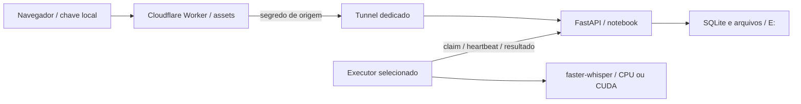

# tts / faysk

Laboratório aberto de **transcrição de voz para texto** em [tts.faysk.dev](https://tts.faysk.dev). O nome do projeto é tts; sua função é speech-to-text.

Frontend em cinzas e azul elétrico servido por Cloudflare Workers. API, SQLite, arquivos e inferência no notebook, no volume E:. Sem serviço de IA pago.

## Arquitetura



- Áudio/vídeo por upload; YouTube por URL de vídeo HTTPS validada. URLs arbitrárias e playlists não são baixadas. O acesso do YouTube pode falhar por bloqueios, restrições ou exigência de autenticação.
- TXT para texto simples; Markdown para notas; SRT para legendas; JSON para segmentos e timestamps.
- Até 90 MB e 2 horas por entrada. Fila global de 20, 10 envios/hora por sessão, 20 tentativas/hora por rede. A chave de sessão é aleatória e apenas seu hash fica no banco. Não há garantia de impedir abuso distribuído; os limites e a execução serial reduzem o impacto.
- O navegador mantém a chave em localStorage. Limpar os dados perde o acesso. Uma sessão anônima perde a chave quando todas as suas janelas forem fechadas. Downloads exigem a chave no header; URLs sozinhas não dão acesso.
- Expiração em 24h contadas desde o envio. Acesso bloqueado imediatamente ao expirar; limpeza física a cada 30s enquanto a API está ligada, ou no próximo início. Temporários órfãos também são limpos. Sem backups dos uploads.
- Após expirar, remove mídia, transcrições, título, fonte e vínculo com a sessão. Mantém ID aleatório e métricas técnicas para análise, sem conteúdo e sem IP bruto. Hashes de rede usados no limite são descartados após uma hora.
- A Cloudflare intermedeia uploads e respostas. “Processamento local” refere-se à inferência; a mídia passa pelo proxy da Cloudflare.
- API escuta somente em loopback. Origem exige segredo do edge em produção. Administração e executores usam chaves próprias. Não publique `.env`.

## Rodar no Windows

Requisitos: Python 3.11+, `uv`, Node 22+ para publicar e FFmpeg no PATH para fluxos que precisarem dele. A decodificação de uploads usa PyAV. Instale dependências pelo lockfile:

```powershell
uv sync --group dev
Copy-Item .env.example .env
# Gere três segredos independentes e substitua os exemplos em .env.
.\scripts\start.ps1
```

Em modo local, deixe `TTS_REQUIRE_EDGE=0` e abra `http://127.0.0.1:8765`. Produção usa `TTS_REQUIRE_EDGE=1`, `TTS_EDGE_KEY` no Worker e na API, `TTS_TUNNEL_TOKEN` e `TTS_CLOUDFLARED` no `.env`. `TTS_TMP` deve ficar no E:. O primeiro uso de um modelo baixa os pesos em `models/`; isso entra no tempo de execução.

```powershell
# Dependências CUDA opcionais (cuBLAS 12 + cuDNN 9)
uv sync --extra gpu --group dev
# Encerrar apenas processos identificados deste projeto
.\scripts\stop.ps1
```

O painel em `/admin.html` pede `TTS_ADMIN_KEY`, disponível somente no `.env` local. A chave fica em memória na aba, sem localStorage. O painel seleciona executor, modelo, CPU/GPU, precisão e pausa da fila. Alterações valem para o próximo trabalho.

Para outro PC, clone o repositório, instale as dependências, defina `TTS_URL=https://tts.faysk.dev`, `TTS_WORKER_ID=pc-3090` e a chave `TTS_WORKER_KEY` em um `.env` privado; execute `python -m server.worker`. Ele aparece no painel após o primeiro heartbeat/claim. Não é necessário abrir portas nesse PC. Os executores são confiáveis e a chave compartilhada dá acesso às entradas que recebem; não use agentes de terceiros.

S7 e S23+ ainda não são executores suportados. Precisam de um agente Android e motor compatível (por exemplo, avaliar whisper.cpp); não basta selecionar CUDA. O protocolo HTTP permite acrescentar esse agente sem mover o banco.

## Cloudflare

```powershell
npm ci
# CLOUDFLARE_ACCOUNT_ID e CLOUDFLARE_API_TOKEN no ambiente
# ou CF_CREDENTIAL_FILE apontando para documento local com um único Bearer
python scripts/cloudflare.py
```

O provisionador cria/reutiliza somente `faysk-tts`, Tunnel dedicado e `tts-origin.faysk.dev`; publica o Worker em `tts.faysk.dev` e envia o segredo por stdin. Preserva DNS de origem que já aponte para outro destino. Credencial da conta não é salva no repositório. O token do Tunnel deste projeto fica no `.env` ignorado. Use `npm run deploy` para publicação rotineira, preservando `ORIGIN` na configuração/argumentos.

## Verificar e medir

```powershell
uv run pytest -q
npm run check
```

Os testes verificam isolamento entre sessões, exports, expiração e remoção do conteúdo, limites, roteamento manual, claims e leases. Inference real deve ser testada separadamente com mídia conhecida.

O painel registra modelo, executor, dispositivo, precisão, bytes, duração, tempo total, CPU em segundos e picos amostrados de RAM/VRAM. RTF = tempo/duração. VRAM pode não estar disponível via NVIDIA no Windows; `n/d` não significa consumo zero. Tempo inclui carregar/baixar modelo e preparar mídia. Não há medição de energia, temperatura, utilização GPU contínua ou precisão automática nesta versão. Use referência humana para WER/CER e compare configurações com a mesma mídia. Os resultados de benchmark não prometem capacidade para qualquer carga.

Enquanto o notebook estiver suspenso, desligado ou sem rede, a interface continua acessível e a API fica indisponível. Os scripts de início são manuais nesta versão; não há serviço de inicialização automática instalado.

MIT. Licenças e termos dos modelos, bibliotecas e mídias enviados continuam aplicáveis.
